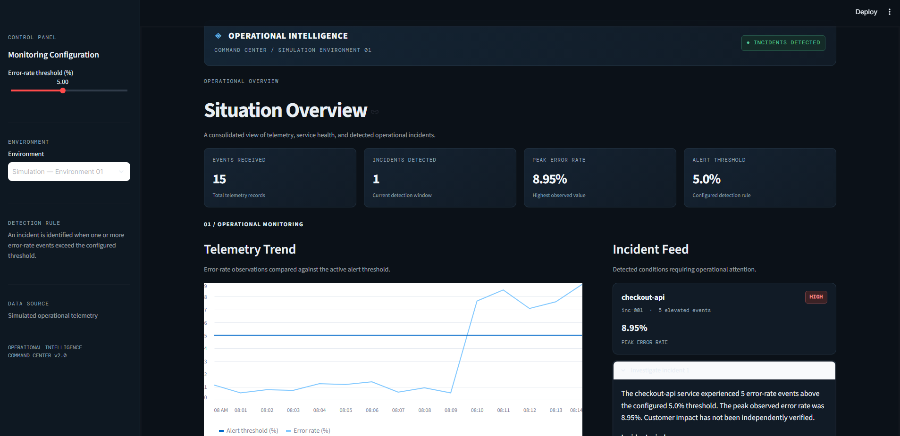
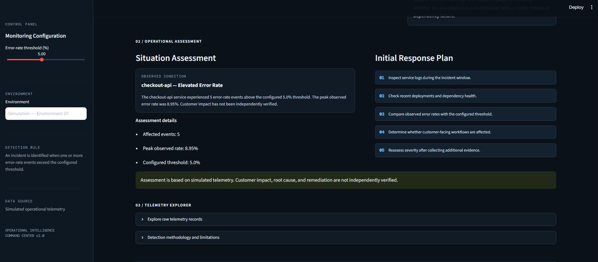

# ◈ Operational Intelligence Demo

**An operational monitoring and incident triage prototype built with Python and Streamlit.**

Operational Intelligence transforms simulated telemetry into explainable incidents, supporting evidence, and recommended investigative actions through an interactive command-center dashboard.

[**Live Dashboard**](https://t-anano-operational-intelligence-demo-app-crkdfp.streamlit.app/) · [**GitHub Repository**](https://github.com/t-anano/operational-intelligence-demo)

---

## Dashboard Preview

### Operational Command Center



### Incident Investigation



---

## Problem

Operational teams must distinguish meaningful service degradation from routine system activity. Identifying abnormal behavior is only the first step; teams also need supporting evidence and a structured starting point for investigation.

This project demonstrates a simplified operational intelligence workflow that processes telemetry, detects elevated error rates, groups observations into incidents, and presents actionable investigative context.

## Solution

Operational Intelligence provides a centralized interface for:

- Monitoring simulated service telemetry.
- Configuring error-rate detection thresholds.
- Identifying elevated error-rate events.
- Grouping observations into incident summaries.
- Examining supporting evidence and incident time windows.
- Reviewing recommended investigation steps.

The goal is to make operational signals easier to interpret and act upon—not to automate decisions without evidence.

## Current Capabilities

| Capability | Description |
|---|---|
| Telemetry generation | Generates repeatable simulated operational events. |
| Schema validation | Validates required fields, ISO 8601 timestamps, numeric values, and severity. |
| Threshold-based detection | Identifies error-rate observations exceeding a configurable threshold. |
| Incident grouping | Groups elevated observations into an incident summary. |
| Evidence reporting | Displays affected-event counts, peak error rates, time windows, and supporting evidence. |
| Investigation guidance | Recommends initial investigative actions. |
| Interactive dashboard | Presents operational metrics, telemetry trends, and incident information. |
| Automated testing | Uses pytest to test event validation and incident detection. |

## Technology Stack

- **Python** — telemetry processing and incident detection.
- **Streamlit** — interactive command-center interface.
- **Pandas** — tabular data processing and visualization preparation.
- **pytest** — automated testing.
- **Structured event data** — simulated telemetry input.

## Demonstration Scenario

The included deterministic dataset contains an elevated checkout API error rate.

At the default **5.0% alert threshold**, the detector identifies five elevated events and reports a peak observed error rate of **8.95%**.

Operators can adjust the threshold through the dashboard and observe how detection sensitivity changes.

This demonstrates a basic operational workflow:

1. Generate telemetry.
2. Validate incoming event records.
3. Evaluate observations against a configurable threshold.
4. Group elevated observations into an incident.
5. Present evidence and investigative recommendations.

## Run Locally

### Prerequisites

- Python 3.10 or later recommended.
- Git.
- pip.

### 1. Clone the repository

```bash
git clone https://github.com/t-anano/operational-intelligence-demo.git
cd operational-intelligence-demo
```

### 2. Create a virtual environment

```bash
python -m venv .venv
```

### 3. Activate the environment

**Windows PowerShell:**

```powershell
.\.venv\Scripts\Activate.ps1
```

**macOS / Linux:**

```bash
source .venv/bin/activate
```

### 4. Install dependencies

```bash
pip install -r requirements.txt
```

### 5. Run automated tests

```bash
python -m pytest -q
```

### 6. Launch the dashboard

```bash
python -m streamlit run app.py
```

Streamlit will provide a local URL for interacting with the application.

## Engineering Design Considerations

**Input validation**

Telemetry events are validated before incident detection. Timestamp validation requires timezone-aware ISO 8601 strings, while numeric values must be finite.

**Explainability**

Incident summaries expose the observations behind a detection, including event counts, peak values, and configured thresholds.

**Human oversight**

Recommended actions are investigative suggestions. The application does not independently establish root cause, verify customer impact, or execute remediation.

**Testability**

The detection and validation logic are separated into Python modules, allowing core behavior to be tested independently of the dashboard.

## Limitations

- Telemetry is simulated and deterministic.
- The application is not connected to production infrastructure or live monitoring systems.
- Detection currently relies on a configurable error-rate threshold.
- Incident grouping does not independently establish causal relationships.
- Customer impact is not independently verified.
- Recommended actions are not automated remediation.

## Roadmap

- [ ] Distinguish transient threshold crossings from sustained degradation.
- [ ] Introduce evidence-based incident severity prioritization.
- [ ] Add incident timelines and trend analysis.
- [ ] Improve incident selection and service-level filtering.
- [ ] Expand automated tests for edge cases and detection behavior.
- [ ] Add structured application logging.
- [ ] Record a short end-to-end product demonstration.

## Project Status

**Working prototype — deployed and tested.**

The application is deployed, its core telemetry validation and incident detection workflow is implemented, and the current automated test suite passes.

---

*Built as a demonstration of operational monitoring, explainable incident detection, and evidence-driven investigation.*